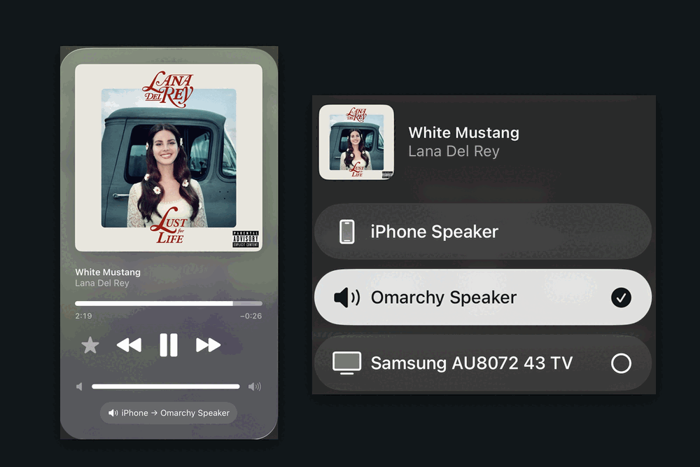

# OmairPlay


Turns your Omarchy machine into an AirPlay speaker. Tap it in your phone's
AirPlay list and the audio comes out of your speakers — no desktop client, and
playback stays on the phone.

It wraps the terminal tool `shairport-sync` with a GUI: it installs what's
needed, opens only the ports AirPlay uses and only to your local network, puts
the receiver's state in your bar, and shows what's playing in your theme.

## Requirements

| | |
|---|---|
| Omarchy | 4.0.3 or newer (plugin API) |
| Audio | PipeWire with `pipewire-pulse` (the Omarchy default) |
| Discovery | `avahi-daemon` running (the Omarchy default) |
| Packages | `shairport-sync` and `nqptp` — **setup installs these** |
| Firewall | `ufw`, if enabled — **setup adds the rules** |

## Install

```bash
omarchy plugin add https://github.com/dmatthan/omairplay --enable
```

Then click the new bar icon and choose **Run setup**.

## Setup, and what it needs root for

Setup opens a terminal so you can read every command before approving the
password prompt. It:

1. Takes a system snapshot (`omarchy snapshot create`), if snapper is configured.
2. Installs `shairport-sync` and `nqptp`.
3. Enables `nqptp` as a **system** service — it needs privileged ports 319 and
   320 for AirPlay 2 clock sync.
4. Adds `ufw` rules **limited to private networks**, never to Anywhere, each
   tagged `omairplay`:

   ```bash
   sudo ufw status | grep omairplay
   ```
5. Writes the receiver's config and a user service under `$HOME`.

**The plugin itself never needs root while running** — only setup, Repair and
removal do, each visibly in a terminal. The receiver is a user service,
`omarchy-airplay.service`. A machine gets one AirPlay 2 receiver, so if a
packaged `shairport-sync` unit is enabled, setup names it and says how to
disable it.

## Using it

Pick your machine from the AirPlay list on your phone, and play:



The bar icon shows the receiver's state: dimmed when off, a cast icon while
playing, the alert colour when it needs repair. Click it for the popup;
right-click turns the receiver on or off. In the popup, `j`/`k` or the arrows
move, `Enter` activates and `Esc` closes.

The popup shows what's playing and from which device, with the cover art, the
sender's volume and a level meter driven by the receiver's real output. Each
new track raises a notification. Colours and font follow your Omarchy theme:


## Settings and repair

Everything else is under **Settings** in the popup: start at login, speaker
name, track notifications, cover art, Repair and Uninstall. Renaming and Repair
interrupt playback, so each asks first. The two toggles are also bar settings:

```bash
omarchy bar set io.github.dmatthan.omairplay trackNotifications false
omarchy bar set io.github.dmatthan.omairplay showArtwork false
```


If the speaker shows up on your phone but won't play, the popup names the
reason (a missing firewall rule, a new IPv6 prefix, clock sync down, or no
audio arriving) with a **Repair** button beside it. Repair redoes the setup for
the addresses your machine has now: one terminal, one password prompt, the
receiver put back as it was. A stalled receiver restarts on its own, up to
twice in 15 minutes, before asking.

## Uninstalling it

1. **Uninstall** in the popup: stops the receiver, disables it at login, deletes
   its config and cover art, removes the firewall rules it added, and turns
   `nqptp` back off if setup was what enabled it.
2. Remove the plugin:

   ```bash
   omarchy plugin remove io.github.dmatthan.omairplay
   ```

Removing the plugin first is fine — the uninstaller keeps its own copy:

```bash
~/.local/state/io.github.dmatthan.omairplay/airplay-remove --system
```

The `shairport-sync` and `nqptp` packages stay installed.

## What it puts on your system

| Path | What it is |
|---|---|
| `~/.config/shairport-sync/shairport-sync.conf` | the receiver's config, from your settings |
| `~/.config/systemd/user/omarchy-airplay.service` | the service that runs the receiver |
| `~/.cache/shairport-sync/` | cover art as sent, the rebuilt copies the popup shows, and the receiver's metadata pipe |
| `~/.local/state/io.github.dmatthan.omairplay/` | the uninstaller and the helpers the service needs |
| `ufw` rules | each tagged `omairplay`, private ranges only — the count depends on which ranges your machine is on |
| `nqptp.service` | enabled, for AirPlay 2 clock sync |
| `shairport-sync`, `nqptp` | packages, from Arch `extra` |

Only the last three touch anything outside `$HOME`: no autostart entries, no
`PATH` changes, no profile edits, no scheduled jobs. Removal reverses all of it.

## Notes on safety

Omarchy plugins run unsandboxed with your user's permissions, this one included:

- Root is used only by setup, Repair and removal, each run visibly in a terminal.
- Firewall rules cover private ranges only, never Anywhere, and `ufw` is never
  disabled or reset. Every rule is tagged `omairplay`, and removal finds them by
  that tag.
- Your local network is the trust boundary: any device on it can play to the
  receiver, without pairing. Turn the receiver off on networks you don't trust.
- Cover art is whatever the sending device sends, so the popup and
  notifications never show it as sent: only a copy rebuilt from its image data,
  PNG or JPEG only, size-capped, with all metadata removed.
- Track titles, artists, albums and the sending device's name are shown as
  plain text, length-capped, so markup in them is never interpreted or fetched.
- Commands are called by full path, in an environment the scripts build
  themselves, so nothing inherited from your session changes what runs.

## Licence

MIT — see [LICENSE](LICENSE).
